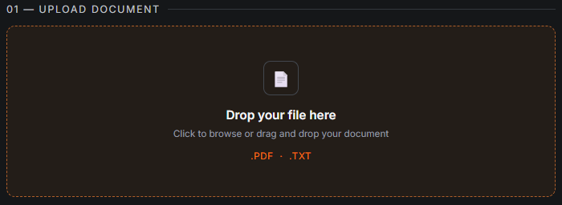
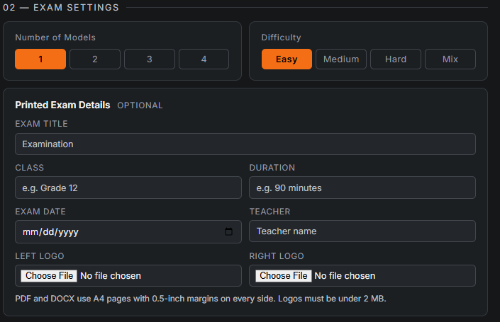
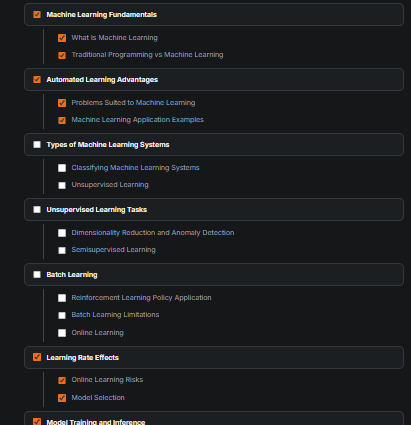
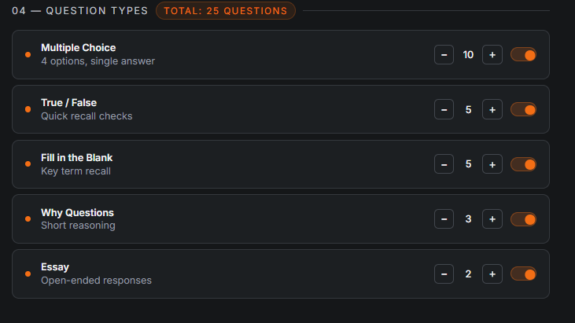
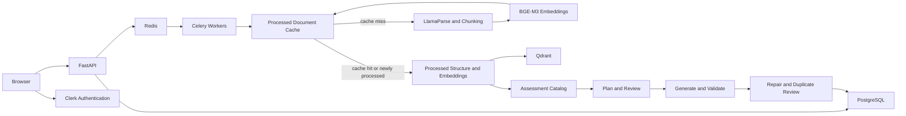
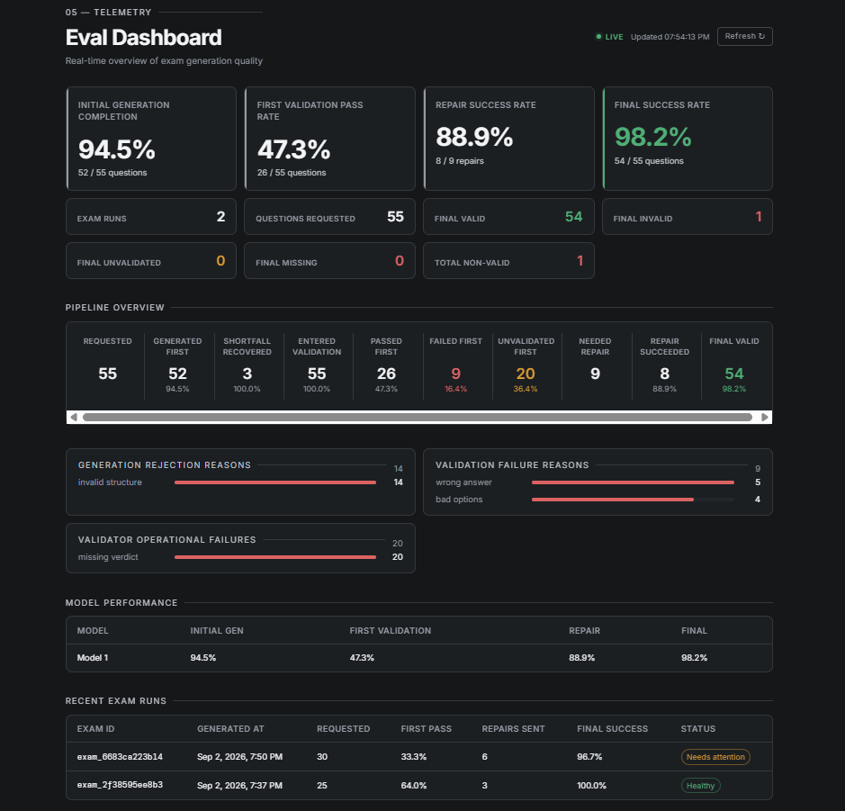

# DraftWork

DraftWork is an AI-powered exam generator that turns educational documents into structured, source-grounded exams.

Upload a PDF or text document, choose the sections you want to use, select the difficulty and question types, and generate one or more exam models with answer keys.

Instead of relying on one large AI prompt, DraftWork builds an assessment catalog from the selected material, plans the requested work, generates questions against assigned evidence, and checks the result before presenting it to the user.

## Product Preview



## What You Can Do

* Upload educational PDF or text documents
* Choose which sections should be included in the exam
* Select Easy, Medium, Hard, or mixed difficulty
* Choose the number and type of questions
* Generate multiple exam models
* Generate MCQ, Fill-in-the-Blank, True/False, Definition, Why, Equation, Word Problem, and Essay questions
* Generate answer keys automatically
* Preview exams before downloading
* Export exams as PDF or DOCX
* Receive a clear partial result when the selected material cannot support every requested question
* Use DraftWork without creating an account
* Save exams and reopen them later after signing in

## How DraftWork Works

1. Upload an educational document.
2. DraftWork processes and organizes its content.
3. Choose the sections you want to include.
4. Select the difficulty, question types, and number of questions.
5. DraftWork retrieves the selected content and builds an assessment catalog of grounded tasks.
6. The pipeline allocates and reviews a plan, then generates questions from evidence assigned to each task.
7. It validates and repairs question-level issues, then checks the completed exam for questions that require substantially the same work or have overlapping answers.
8. Review the complete or partial exam and answer key, then export the result as PDF or DOCX.

## Workflow Screenshots

### Configure the Exam



### Select the Content



### Choose Question Types



## Multi-Stage AI Generation

Exam generation is divided into focused stages rather than handled by one large model request:

* **Assessment Catalog** turns the selected material into source-grounded tasks and, where appropriate, a controlled fill-in-the-blank answer bank.
* **Planner and Plan Review** allocate those tasks to the requested exam slots and catch unsupported requests or repeated assessment work before generation.
* **Generator** creates each question from the task and its assigned evidence.
* **Validator and Repairer** check structure, answer validity, quantitative work, and task alignment, then repair only the affected slot.
* **Duplicate Review** checks whether questions require substantially the same assessment work, reasoning, or overlapping answers, then replaces conflicts when a suitable alternative is available.

```text
Selected Content
      ↓
Assessment Catalog
      ↓
Plan and Review
      ↓
Generate by Slot
      ↓
Validate and Repair
      ↓
Duplicate Review
      ↓
Complete or Partial Exam
```

This structure keeps each stage focused. It also lets DraftWork preserve valid work when one slot needs repair and report a shortfall when the available material cannot support a reliable replacement.

## Document Retrieval

DraftWork does not repeatedly send the complete uploaded document to the language model.

Documents are parsed with **LlamaParse**, cleaned, and divided into meaningful sections. **BGE-M3** creates dense and sparse embeddings, while **Qdrant** stores the vectors and performs hybrid retrieval. Processed documents are cached by their content and processing version, so identical uploads can reuse parsing and embedding work while still receiving separate document records.

The planner receives the selected material to build its catalog and exam plan. Generation and validation then use the evidence assigned to each task, which keeps individual requests focused on the source material that supports that question.

## Accounts and Saved Exams

Creating an account is optional. Users can upload documents and generate exams anonymously.

If they sign in later, their current session and generated exams are linked to their account instead of being lost. Authentication is handled through **Clerk**, with support for Google and email/password sign-in.

After signing in, the profile menu provides:

* **Manage account**
* **My Exams**
* **Sign out**

**My Exams** opens directly inside the generator. Saved exams can be reopened in the existing Exam Preview and exported again as PDF or DOCX. If the source material cannot support every requested slot, the saved result identifies the partial status and missing question types rather than presenting it as complete.

The frontend sends the active Clerk session token to FastAPI through the `Authorization` header. Authentication tokens are not stored in PostgreSQL, `localStorage`, or `sessionStorage`.

Signing out keeps the user's saved exams attached to their account and starts a new anonymous DraftWork session in the browser.

## Built for Multiple Users

A major part of preparing DraftWork for deployment was making sure different users could use the application without their data being mixed together.

The backend enforces ownership for:

* Uploaded documents
* Processing and generation jobs
* Generated exams
* Exports
* Retrieved document data

Long-running document processing and exam generation run as background jobs instead of blocking the main API. DraftWork uses **FastAPI**, **PostgreSQL**, **Celery**, **Redis**, **Qdrant**, **Clerk**, and **Docker** to support this workflow. Exam runs retain lifecycle and audit data for planning, validation, repair, and duplicate-review stages.

## About the Project

DraftWork started as a project I built while studying Computer Science.

The first idea was simple: upload educational material and use AI to generate an exam from it. As I kept building, the project grew to include document processing, retrieval, catalog-based planning, structured generation, validation and repair, background jobs, persistent storage, authentication, user isolation, saved exams, and exports.

A big part of this project has been learning what it takes to move from an AI prototype that works locally to an application that can actually be used by different people.

## Project Status

The main DraftWork workflow works end to end:

```text
Upload
→ Process and Cache
→ Select Sections
→ Configure Exam
→ Retrieve Selected Content
→ Build Assessment Catalog
→ Plan and Review
→ Generate by Slot
→ Validate / Repair / Review Duplicates
→ Preview
→ Export
```

Persistent storage, background jobs, authentication, saved exams, account ownership, multi-user isolation, monitoring, cleanup, and generation audit history are also implemented as part of preparing DraftWork for deployment. The system can preserve a partial result with explicit shortages when it cannot produce every requested question reliably.

There are still final deployment and real-world usage checks to complete, but DraftWork is getting close to its first public online release.

## Architecture



FastAPI serves the frontend and API. PostgreSQL stores application, account, exam, and audit data; Redis and Celery manage background work; and Qdrant stores document vectors used during retrieval. Clerk provides authentication while DraftWork keeps application ownership rules in its own database.

## Testing

DraftWork includes automated tests for document processing and caching, retrieval, assessment-catalog allocation, plan review, API validation, background jobs, generation and repair contracts, duplicate detection, partial-exam lifecycle handling, authentication, session claiming, account ownership, exports, cleanup, migrations, and monitoring.

The project also records generation and validation results so exam quality can be reviewed across models and question types.


